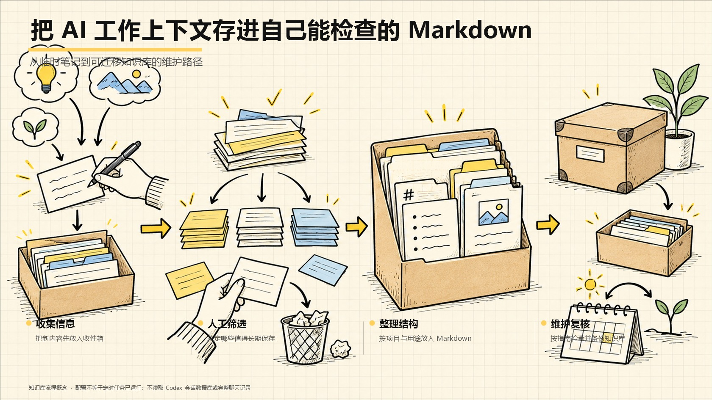

# MindDock

> 用普通 Markdown 管理项目知识、待确认信息与维护流程，让 AI Agent 按需读取，也让你能自己检查和备份。

 [](LICENSE)


[English README](README.en.md) · [English cover](assets/portfolio-promo-2026-11-02/cover-en.jpg) · [English overview](assets/portfolio-promo-2026-11-02/overview-en.jpg)

MindDock 是配合支持 Agent Skills 的 Codex 使用的记忆工作流 Skill。你提供项目资料与想保留的事实，它帮助把信息整理成可审阅的 Markdown 文件；重要内容先进入候选区，由你确认后再纳入长期项目知识。

[快速开始](#六安装与快速开始) · [日常使用](#七如何使用)

## 一、这个项目是什么？

MindDock 是一套可由 Codex Skill 执行的工作方法和普通 Markdown 文件结构，不是独立记忆软件或后台服务。Skill 是一份指导 AI 按指定方法完成任务的操作指南，需要在支持 Skills 的工具中使用。

你可以要求它为项目建立知识库、整理候选信息、设置路由规则，并在本地能力可用时配置每日或每周维护。笔记可以直接由人阅读，也兼容 Obsidian。

## 二、先看效果



> AI 概念插画：说明“候选信息—人工确认—项目知识”的工作方式，不代表真实软件界面或定时任务运行结果。

一个典型输入是当前项目资料、已确认的偏好或待整理的决定；使用 Skill 后，相关 Markdown 文件会写入项目内的 <code>codex-memory/</code>。实际是否创建了定时任务、任务是否按时执行，仍需在你的 Codex 环境中检查。

## 三、适合谁用？

### 特别适合
- 用 Codex 跨多次任务推进项目，希望把确认过的背景留在项目中的创作者。
- 想用可读、可备份的 Markdown 管理 AI 工作资料的人。
- 希望新信息先审阅、保留来源，再决定是否写入长期笔记的人。

### 不适合
- 需要自动读取完整 Codex 聊天记录、会话数据库、密码或客户敏感信息的人。
- 需要不经人工确认的永久记忆服务或常驻后台服务的人。
- 当前使用的 AI 工具不支持 Codex Skills，且不愿手动使用 Markdown 工作流的人。

## 四、你会得到什么？

按需配置后，项目内会有一个 <code>codex-memory/</code> Markdown 知识库、供 Codex 按任务读取的路由说明，以及可供维护和审阅的候选记录。文件保存在你自己的项目目录中，可以继续编辑、复制、备份或用 Obsidian 打开。

每日和每周维护默认时间为本地 22:00、周日 22:30；这是配置意图，不等于任务已被操作系统或 Codex 成功安排并实际运行。

## 五、它能帮你解决什么问题？

当项目资料散落在笔记、旧对话和临时文件里，下一次任务容易缺少背景。MindDock 提供一个文件化入口，把“已经确认的项目事实”和“仍待判断的信息”分开放。

它能减少重复说明和寻找资料的工作；你仍需要检查候选内容、处理事实冲突，并确认自己的环境是否支持定时维护。它不承诺永不遗忘，也不能替代你自己的备份。

## 六、安装与快速开始

需要一个支持 Agent Skills 的 Codex 环境，以及可访问本地项目文件的权限。Skill 本身不要求数据库；第三方模型或服务的费用按你使用的工具和服务商规则计算。

在仓库根目录打开 PowerShell，执行：

```powershell
$skillsDir = Join-Path $env:USERPROFILE '.codex\skills'
New-Item -ItemType Directory -Force -Path $skillsDir | Out-Null
Copy-Item -Recurse -LiteralPath '.\skills\codex-memory-workflow' -Destination (Join-Path $skillsDir 'codex-memory-workflow')
```

如果目标目录已经存在，请先检查已有文件，再自行决定更新方式，不要直接覆盖。完成后在 Codex 新任务中输入：

```text
$codex-memory-workflow Configure this project using the portable defaults.
```

成功后，检查当前项目根目录是否出现 <code>codex-memory/</code> 和相关说明文件。更详细的安装验证见 [Skill 安装说明](skills/codex-memory-workflow/README.md)。

## 七、如何使用？

可以在支持 Skills 的 Codex 任务中复制下面的中文指令，并补上项目资料或要记录的事项：

```text
$codex-memory-workflow
请为当前项目整理记忆库。先列出准备新增或更新的内容、
每条内容的来源和不确定之处，等我确认后再写入。
```

日常使用时，可以让 Codex 先查阅当前项目记忆，再处理任务；新增的重要偏好或决定先进入 <code>inbox/</code>，由你检查后再提升。不要把 API Key、Cookie、证书或客户敏感资料放入记忆库。

## 八、项目工作流程

准备项目资料 → 调用 Skill 配置 Markdown 知识库 → 把新信息放入候选区 → 人工核对来源与冲突 → 确认后整理为项目知识 → 按需检查维护任务。

文件创建和整理由 Skill 辅助；决定什么信息长期保留、检查定时任务是否真正运行，由你完成。

## 九、项目目录结构

- <code>skills/codex-memory-workflow/SKILL.md</code>：Skill 入口与工作规则。
- <code>skills/codex-memory-workflow/README.md</code>：安装和验证说明。
- <code>skills/codex-memory-workflow/references/</code>：知识库布局、日常提示词和维护配置参考。
- <code>codex-memory/</code>：运行时在你的项目中创建，保存项目知识与待审候选。

## 十、注意事项与常见问题

- **配置显示成功，是否代表每天都会运行？** 不代表。请观察你自己的 Codex 环境中的首次实际运行；能力不可用时按说明手动执行。
- **它会导入旧聊天记录吗？** 不会读取或复制 Codex 会话数据库、完整聊天记录、密钥、Cookie、证书或客户敏感数据。
- **它会覆盖现有笔记吗？** 工作流强调幂等设置与保留已有内容；更新前仍应审阅候选差异并自行备份。
- **它是 Codex 原生 Memories 的替代品吗？** 不是。项目文件是外部 Markdown 知识库，不应冒充原生 Memories。

Skill、Markdown 文档、提示词和模板采用 [MIT License](LICENSE)；作者图片不包含在该许可范围内。

## 十一、版本说明

当前仓库说明没有标出可核实的版本号。请以仓库实际文件和 [更新记录](https://github.com/yangjing6213-dev/MindDock/commits/main/) 为准；不把 README 修改日期当作版本发布日期。

## 十二、相关项目

无。当前仓库没有在此处列出有明确依赖关系的其他作品。

## 十三、关于作者

**Enhe（恩禾）｜产品设计师 · 一人公司实践者 · AI Builder**

用 AI 打造一人公司。

- GitHub：[yangjing6213-dev](https://github.com/yangjing6213-dev)
- X / Twitter：[Amenenhe_ai](https://x.com/Amenenhe_ai)
- 网站：[恩禾 ENHE AI](https://www.enhe-tech.com.cn/)
- 微信：Hu-Amen
- 邮箱：[amen.enhe@gmail.com](mailto:amen.enhe@gmail.com)

作者图片见 [assets/about-author.png](assets/about-author.png)。该图片不在 MIT License 授权范围内，复用前需取得作者许可。

## 十四、继续探索

MindDock 是我整理个人 AI 工作资料的一种方式：先留下可读、可核对的项目背景，再决定哪些信息值得继续保存。如果你也在用 AI 管理知识、制作内容或搭建个人工作流，可以到 [恩禾 ENHE AI](https://www.enhe-tech.com.cn/) 继续看看。

